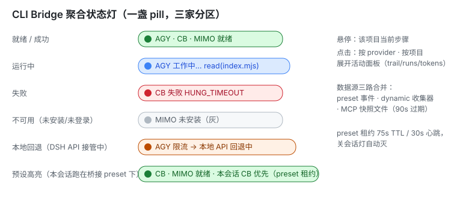

# cli-bridge

**简体中文** · [English](README.en.md)

> 一个用于 **DeepSeek Harness (DSH)** 的 Cordis 插件包：把编码/构建/调试/排查等实际工作
> **优先派发给本机 CLI agent** —— Google **Antigravity（`agy`）**、腾讯 **CodeBuddy Code**、
> 小米 **MiMo（MiMoCode CLI / MiMo Desktop）** —— DSH 全程掌控这些 CLI（非交互、无提示），
> 并在 **限流 / 网络不通** 时弹窗让用户选择是否回退到 **DSH 本地 API 配置**；会话标题栏提供
> **一盏聚合实时状态灯**（三家分区），设置面板统一三家偏好与凭据。
>
> 本包整合并取代三个旧包：`agy-first-bridge`（1.7.1 终版）、`codebuddy-first-bridge`（1.6.2 终版）、
> `mimo-first-bridge`（1.2.9 终版）。旧包已 deprecated，功能全部并入此处；迁移见
> [docs/MIGRATION.md](docs/MIGRATION.md)。



---

## 这是什么

`@luchenglong/cli-bridge` 给运行中的 DSH 注入：

1. **每家三个模型工具** —— `<id>_run` / `<id>_continue` / `<id>_status`
   （agy 另有 `agy_quota`，mimo 另有 `mimo_settings`），把任务转交给本机 CLI 执行；
   **工具名与入参语义与旧包逐字一致**，历史会话提示词零改动继续可用。
2. **一段 CLI 优先策略提示**（每家各自 POLICY 段），让模型在所有模式下优先把实际工作
   派发给对应 CLI，原生工具只用于只读查询与最终验证。
3. **一盏聚合状态灯（家级插件，随 DSH 启动加载）**：标题栏 pill 汇总三家状态
   （绿=就绪/成功、黄=运行中、红=失败、灰=不可用、琥珀=本地回退、preset 高亮=本会话运行在桥接预设下）；
   悬停看当前步骤，点击展开按 provider、按项目（工作目录）的活动面板 ——
   每项目实时步骤折叠（当前工具 + 参数摘要 + 轨迹）、runs/tokens 累计、最近完成运行。
4. **统一设置面板**（DSH 设置页「CLI Bridge」段）：**横向标签页** —— 「总设置」+ 每个 CLI 一页，
   点名字切换、同屏只渲染一张卡（页长不随 CLI 数量增长）；每家字段由 provider 自己声明
   （meta 驱动渲染）；token 类字段永不明文回传；保存写
   `{DSH_HOME}/cli-bridge-settings.json`（按 provider 分区）；**旧包设置文件自动一次性迁移**。
5. **调度（0.2.0+）**：「总设置」页勾选**启用哪些 CLI**（决定调用面数量）+ `↑↓` 排定**调用优先级**，
   一次保存同时贯通预设、动态宿主与 MCP 三种形态 —— 详见 [调度](#调度启用哪些-cli与调用优先级)。

## 四种形态

同一套 provider 描述符（单一事实来源）驱动四种落地形态：

| 形态 | 位置 | 能力 | 状态灯 |
| --- | --- | --- | --- |
| **持久 Agent Preset**（推荐） | [`preset/<dir>/`](preset/) | 工具 + POLICY + 回退弹窗 + 三家预设（`cordis-agy` / `codebuddy-first` / `cordis-mimo`） | ✅（家级灯自动点亮） |
| **家级插件（指示灯+设置+声明注册）** | [`home-plugin/cli-bridge-indicator/`](home-plugin/cli-bridge-indicator/) | HTTP 路由 + 浏览器 pill/面板/设置 + **preset 声明制注册** | 本体 |
| **动态宿主（沙箱插件）** | [`dynamic/<id>.host.js`](dynamic/)（由模板生成） | 无 preset 时在任意组合里挂载工具 | ✅（经收集器汇入） |
| **MCP stdio server** | [`mcp/cli-bridge-mcp.mjs`](mcp/)（bin `cli-bridge-mcp`） | 任何 MCP 客户端（Claude Code/Cursor/DSH 外部）直连本机三家 CLI | ✅（快照文件桥接，见下） |

MCP 接入（一个 server 暴露全部三家工具；只想要一家用兼容入口或 `--provider=`）：

```json
{
  "mcpServers": {
    "cli-bridge": {
      "command": "node",
      "args": ["/path/to/node_modules/@luchenglong/cli-bridge/mcp/cli-bridge-mcp.mjs"]
    }
  }
}
```

旧包单家配置迁移：`node mcp/agy-mcp-server.mjs`（等价 `--provider=agy`），env 变量名不变。

**MCP 形态的状态灯**：MCP 是独立进程，没有 `ctx.emit`，故它把每台状态原子写入
`{DSH_HOME}/cli-bridge-mcp-<id>.json`（90s 内有效），家级灯轮询合并 —— 你在 DSH 外面
用 Claude Code 跑 agy，DSH 标题栏照样亮。

## 调度（启用哪些 CLI 与调用优先级）

设置页「CLI Bridge 桥接」→「总设置」标签：勾选要启用的 CLI（决定智能体可调用的 CLI 数量），
`↑↓` 排定调用优先级（首位最高）。每个 CLI 另有自己的标签页（后端字段驱动 + 诊断）。

**落盘**：`{DSH_HOME}/cli-bridge-settings.json` 顶层 `_scheduling = { enabled, priority }`
（下划线前缀 = 非 provider 分区，旧版本读该文件时整区忽略 → 纯增量兼容）。
派生 `order = priority ∩ enabled`：`enabled` 是集合（数组顺序无意义），`priority` 的**数组顺序即优先级**。

**一次配置贯穿四种形态**：

| 生效面 | 行为 |
| --- | --- |
| preset / 动态宿主 | `apply()` 首行门禁：禁用面**不注册任何工具、策略段、心跳**；启用面按优先级排注册顺序 |
| 声明制 preset 注册 | 三个 preset 恒常注册（禁用 ≠ 从目录消失，仍可切入排查），注册顺序按优先级 |
| MCP 形态 | `enabled` 过滤工具面、`order` 排序；启动读一次（重启子进程刷新），家级 `bin\` 服务器**每请求现读**（面板改完立即生效） |
| 状态灯与设置视图 | `GET /cli-bridge/status`、`GET /cli-bridge/settings` 每次轮询现读并附 `scheduling` 快照（`enabled/priority/order/all/labels`） |

**语义与边界**：

- **fail-open**：文件缺失 / 坏值 / 无 fs → 全部启用（读不到配置 ≠ 关掉所有桥）；
  只有**显式** `enabled: []` 才是「全关」，且面板会红字提示「三形态都不会注册任何 CLI 工具」。
- **钉住优先**：env `CLI_BRIDGE_PROVIDER` 或 `--provider=<id>`（MCP 形态的薄封装）优先级最高，
  用于「这个客户端只要 agy」的单面用法；宿主形态传 `ignorePin`，不会被全局 env 反噬。
- **指示灯不长明**：超过 10 分钟无活动且未运行的项目不再渲染为常亮灯（历史仍保留在点击弹窗里）。

**加第 N 家 CLI**：只改 `providers/registry.mjs`（id 唯一轴）+ 交付该 provider 的描述符；
调度卡的选项、标签页、状态灯、设置保存循环与构建派生物全部自动跟上 —— 契约见
[PROVIDER-CONTRACT.md](PROVIDER-CONTRACT.md) §3.1。

## 架构速览

```
providers/registry.mjs ── createProvider(id) ─┬─ providers/agy.mjs      ┐
core/bridge-kit.mjs（状态引擎/runner/限流/     ├─ providers/codebuddy.mjs ├─ 同一描述符驱动
 回退/渲染/MCP 载荷，零 import）               └─ providers/mimo.mjs     ┘   四种形态
home-plugin/cli-bridge-indicator/
  ├ index.mjs      统一状态机（租约/合并/stale） + HTTP 路由 + 收集器
  ├ settings.mjs   分区设置读写 + 掩码 + 旧文件迁移
  ├ preset-declarations.mjs  声明制注册（Form-A 自注册，全版本可用）
  └ client.js      浏览器 pill/面板/设置（标签页 + 调度卡 + 陈旧过滤；注册 id ≡ 包名，红线，CI 锁）
preset/standard-base.mjs + preset/<dir>/plugin-list.mjs ── scripts/build.mjs ──> agent.cordis.yml / preset.yml / dynamic/*.host.js
```

- 开发/移植第三家 CLI？契约见 [PROVIDER-CONTRACT.md](PROVIDER-CONTRACT.md)，一次实现一个描述符即可接入全部形态。
- 为什么 preset id 和工具名不变？旧会话头/提示词引用它们（红线清单在契约 §0）。
- 生成物为什么提交进仓库？fresh clone 直接可装可用；`node scripts/build.mjs --check` 在 CI/prepack 防漂移。

## 安装

```bash
npm install -g @luchenglong/cli-bridge        # MCP 用：cli-bridge-mcp 已在 PATH
```

DSH 接线（home-plugin bundle + presets + 指示灯一次装齐）见 **[docs/INSTALL.md](docs/INSTALL.md)**。
要点：包带 `dsh.bundle.patch`（bundle 面自注册），DSH profile 加入该 bundle 后
三盏能力 + 三家 preset + 设置面板 + 状态灯一次到位；本仓库脚本 `npm run deploy:local`
只做到「暂存目录」，不改运行时接线（需先停 DSH）。

## 开发

```bash
node scripts/build.mjs        # 生成 dynamic 宿主 + legacy YAML
node scripts/verify.mjs       # 发布红线（client id/exports/描述符完整度…）
node --test                   # 单测（含每家 tests/<id>/）
node mcp/cli-bridge-mcp.mjs --check   # MCP 自检
npm run check                 # 三闸门全量
```

## 文档

- [docs/INSTALL.md](docs/INSTALL.md) — 安装与接线（含旧包迁移）
- [docs/ARCHITECTURE.md](docs/ARCHITECTURE.md) — 三形态共享内核设计、状态机与红线论证
- [docs/MIGRATION.md](docs/MIGRATION.md) — 从三个旧包迁移对照表
- [MCP-POLICY.md](MCP-POLICY.md) / [中文版](docs/MCP-POLICY.zh.md) — 给外部 MCP 客户端（Claude Code/Codex）的派发策略卡
- [docs/RELEASE-SOP.md](docs/RELEASE-SOP.md) — 发版流程与红线检查
- [docs/FALLBACK-AND-INDICATOR.md](docs/FALLBACK-AND-INDICATOR.md) — 回退弹窗与状态灯语义详解
- [PROVIDER-CONTRACT.md](PROVIDER-CONTRACT.md) — provider 接入契约（冻结）
- [CHANGELOG.md](CHANGELOG.md) + [docs/history/](docs/history/) — 统一历史与三家 lineage 全量历史

## 许可

[MIT](LICENSE)
